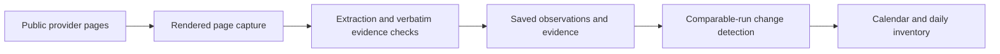

# Offer Calendar

An evidence-first dashboard for observing public home-internet offers across T-Mobile, AT&T and Verizon. Compare daily observations, review original wording, and distinguish promotions, included benefits and plan pricing.

This is a sanitized standalone source release. The local demo uses explicitly illustrative records. No customer data, internal captures, deployment endpoints, credentials or original Git history are included. Example prices and excerpts are test inputs, not current offers.

## Run the local demo

Python 3.11 or newer:

```bash
python3 -m venv .venv
source .venv/bin/activate
python -m pip install -r requirements-dev.txt
cd apps/offer-calendar
OFFER_CALENDAR_PREVIEW=1 DATABRICKS_APP_NAME=offer-calendar-fiber streamlit run app.py
```

Use `offer-calendar-hsi` for the fixed-wireless view. The demo needs no Databricks account or extraction API key. Preview screenshots are intentionally absent; the interface reports missing evidence.

## How it works



- `apps/offer-calendar/`: Streamlit interface, read-only data adapter, comparison logic, synthetic preview and tests.
- `collector/`: standalone rendered-page and extraction runtime plus offline regression tests. Import does not start collection.
- `docs/taxonomy.md`, `prompts/`, `contracts/`: an earlier classification design and manually labelled contract examples. These are not model evaluation results.
- `sql/schema_v3_draft.sql`: an eight-table design proposal using an example namespace. This is separate from the dashboard's existing five-table adapter and is not a live backend bootstrap.

The dashboard uses the latest attempt per source per Pacific calendar day. A failed attempt is not replaced with an earlier success. Material changes require comparable source evidence; missing capture does not prove absence of offers. Observation dates do not establish campaign start/end dates. Machine-detected events remain review candidates.

## Optional Databricks integration

Set `OFFER_CALENDAR_CATALOG`, `OFFER_CALENDAR_SCHEMA`, `DATABRICKS_HOST` and `DATABRICKS_WAREHOUSE_ID` for your own environment. The adapter expects the source, run, snapshot, card-screenshot and page-evidence tables named in `data_access.py`; those live schemas and data are not supplied. Set up authentication, table permissions and a screenshot volume yourself. `app.yaml` is a generic Databricks App entry point using an attached SQL warehouse resource; it does not provision infrastructure.

Set `OFFER_CALENDAR_HSI_URL` and `OFFER_CALENDAR_FIBER_URL` for cross-view links. Defaults use reserved example domains. `.env.example` is documentation; variables must be exported or injected by your deployment.

The collector requires a Spark/Databricks runtime, your own tables and volume, Playwright with Chromium, the `scrapegraph-py` package, and `SCRAPEGRAPHAI_API_KEY`. In that environment, load `collector/collector.py`, call `configure(spark, dbutils)`, then explicitly invoke `run_collection()`. Collection calls a paid external service and appends observations. No collection or deployment was performed as part of this release. Provider HTML and API compatibility must be verified before live use.

Email functionality only prepares drafts/digest text; it does not send messages or include recipients.

## Verify offline

From the repository root:

```bash
python -m pytest apps/offer-calendar collector -q
python contracts/validate_design.py
```

Tests exercise comparison gates, quotation checks, classification, missing coverage, screenshot matching, synthetic UI interactions and draft parity. They do not certify live extraction accuracy or production readiness.

See [PUBLIC_RELEASE.md](PUBLIC_RELEASE.md) for the release boundary.
