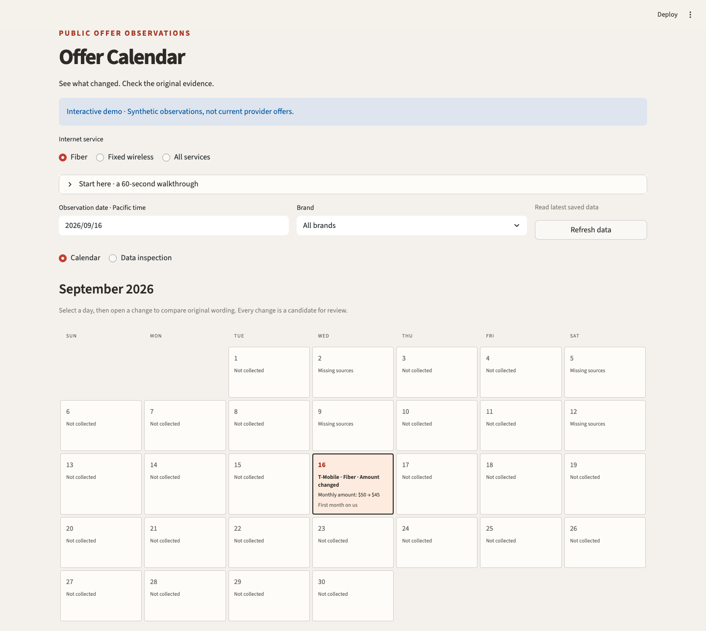
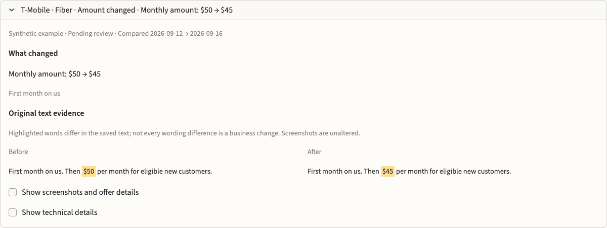
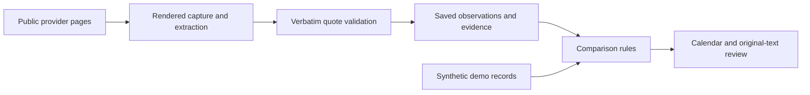

# Offer Calendar

**Track public internet offers. See what changed. Check the evidence.**

[](https://github.com/LobsterQBA/offer-calendar-public/actions/workflows/tests.yml)

Offer Calendar turns captured home-internet offer pages into a daily calendar of reviewable changes. It covers T-Mobile, AT&T and Verizon across fiber and fixed wireless, keeping the original wording behind each candidate change.

The problem: checking provider pages by hand makes it hard to distinguish a real price or benefit change from rewritten extraction text or a failed page capture. This project combines rendered-page collection, source-quote validation, conservative comparison rules and a Streamlit review interface.

**This public version includes a working local demo with synthetic observations.** The prices, dates and screenshots below illustrate the workflow; they are not current provider offers.

[Try the demo](#try-it-locally) · [Read the examples](examples/README.md) · [Explore the code](#where-to-start-reading) · [Cloud integration](docs/databricks.md)

## A month of observations, one change to inspect



Select a day and brand to see observed changes. Switch between **Fiber**, **Fixed wireless** and **All services**. The calendar keeps missing sources and incomplete collection visible alongside change candidates.

Open a change to inspect the original text before and after:



Here, the saved wording changes from **$50 per month** to **$45 per month**. Both observations describe the same offer. The app highlights the literal difference and records a change candidate for human review. The comparison uses the previous successful capture, which may be several days earlier.

## Three situations, three different conclusions

All examples below use synthetic input and run through the same comparison functions as the dashboard.

| What happened? | Result | Why? |
| --- | --- | --- |
| The original monthly amount changes from **$50** to **$45** | One change candidate | The source text supports a change to a matching amount and period. |
| The AI rewrites its description; the saved source text stays identical | **No change** | A different generated summary does not establish a source change. |
| The next page capture fails and produces no offer record | **Collection incomplete** | Missing evidence cannot establish that the offer disappeared. |

Run the examples without a browser or credentials:

```bash
python3 examples/compare_offers.py
```

The first example prints:

```text
1. Original source price changes: $50/mo -> $45/mo
  Result: Monthly amount: $50 → $45
  Change candidates: 1
  Evidence check: source_backed_amount_change
```

[Walk through all three examples →](examples/README.md)

## Try it locally

Use Python 3.11 or newer. From a terminal:

```bash
git clone https://github.com/LobsterQBA/offer-calendar-public.git
cd offer-calendar-public
python3 -m venv .venv
source .venv/bin/activate
python3 -m pip install -r requirements-dev.txt
python3 demo.py
```

On Windows, activate the environment with `.venv\Scripts\activate` instead. Open the local URL printed by Streamlit. The demo starts on **September 16, 2026**, with **Fiber** selected and the amount-change example expanded. It requires no API keys or Databricks account.

Things to try:

1. Read the highlighted **$50 → $45** comparison, then show the supporting offer details.
2. Switch to **Data inspection** to explore captured records and source coverage.
3. Select **Fixed wireless**, then **Verizon**, to see an incomplete capture on the same date.

The demo contains no historical provider screenshots. It labels missing screenshot evidence explicitly. The README images are screenshots of the synthetic local interface.

## How the pieces fit together



The optional collector captures rendered pages and checks extracted fields against the original wording before saving records. The dashboard reads those observations, finds comparable captures and presents candidate changes with evidence. The local demo supplies synthetic records directly to the review workflow.

Three decisions keep the results inspectable:

- **Compare original evidence.** Model summaries and formatting differences alone do not establish a material change.
- **Keep observation history honest.** Use the latest attempt per source per Pacific day, including failed attempts. A collection-method change establishes a new baseline.
- **Preserve uncertainty.** Offer additions/removals require complete comparable captures. Observation dates do not prove campaign effective dates, and every detected change remains pending review.

## Where to start reading

| If you want to understand… | Start here |
| --- | --- |
| A complete comparison with small, readable input | [`examples/compare_offers.py`](examples/compare_offers.py) |
| How the app decides whether something changed | [`change_logic.py`](apps/offer-calendar/change_logic.py) |
| Daily records, source coverage and comparison eligibility | [`dashboard_model.py`](apps/offer-calendar/dashboard_model.py) |
| Calendar presentation and visual styling | [`calendar_view.py`](apps/offer-calendar/calendar_view.py), [`styles.css`](apps/offer-calendar/styles.css) |
| The interactive dashboard and its synthetic data | [`app.py`](apps/offer-calendar/app.py), [`preview_data.py`](apps/offer-calendar/preview_data.py) |
| Rendered capture, extraction and quotation checks | [`collector/collector.py`](collector/collector.py) |
| Classification design and hand-labelled examples | [`docs/taxonomy.md`](docs/taxonomy.md), [`contracts/`](contracts/) |

## Verify the project

From the repository root, with dependencies installed:

```bash
python3 -m pytest apps/offer-calendar collector -q
python3 contracts/validate_design.py
```

The offline suite covers material-change gates, source quotations, classification, failed captures, screenshot matching, synthetic UI interactions and email drafts. The design check validates contract consistency; it does not measure model accuracy.

## Using your own data

The demo is ready to explore locally. Connecting live observations requires your own Databricks tables, volume, SQL warehouse and authentication; paid extraction also needs a ScrapeGraphAI key. See the [cloud integration guide](docs/databricks.md) for the boundary between the existing adapter and the separate draft schema.

This repository is a sanitized source release with fresh Git history. Internal data, credentials and deployment endpoints are excluded. Email features prepare drafts and digest text; delivery is not configured. See [PUBLIC_RELEASE.md](PUBLIC_RELEASE.md) for what is included.
